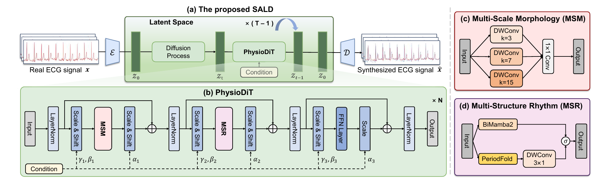

# SALD: Structure-Aware Latent Diffusion for ECG Synthesis

**Submitted to ICASSP 2027.**

SALD generates multi-label ECGs using a VAE and the PhysioDiT denoiser, combining multi-scale morphology and rhythm modeling.



## Setup

Linux, Python 3.10 and an NVIDIA GPU are required. CUDA extensions may require a matching CUDA toolkit and C++ compiler.

```bash
python3.10 -m venv .venv
source .venv/bin/activate
python -m pip install --upgrade pip setuptools wheel packaging ninja
python -m pip install torch==2.11.0 --index-url https://download.pytorch.org/whl/cu128
python -m pip install --no-build-isolation -r requirements.txt
```

## Data

Download [PTB-XL 1.0.1](https://physionet.org/content/ptb-xl/1.0.1/) (`ptbxl_database.csv` and `records500/`) or [CPSC2018](http://2018.icbeb.org/Challenge.html) (original MAT records and `REFERENCE.csv`).

```bash
python src/scripts/preprocess_ptbxl.py --raw-dir /path/to/ptb-xl
python src/scripts/preprocess_cpsc2018.py --raw-dir /path/to/CPSC2018
```

Prepared arrays are saved under `data/`. Each ECG contains eight leads and 1,000 samples at 100 Hz. PTB-XL uses the official folds; CPSC2018 uses the supplied fixed split table. Paths can be changed in `src/configs/`.

## Training and generation

Run from the repository root:

```bash
export CUDA_VISIBLE_DEVICES=0
python src/scripts/train_vae.py --run-name vae_run
python src/scripts/train_dm.py --vae-run vae_run --run-name dm_run
python src/scripts/generate_dataset.py \
  --vae-run vae_run --dm-run dm_run --run-name samples --devices cuda:0
```

The default dataset is PTB-XL. For CPSC2018, add `--config src/configs/physiodit_cpsc2018_label_all9.yaml` to each command. CFG defaults to **1.5**. Model weights are not included; outputs are saved under the configured `output_root`.

## Evaluation

Download `hubert_ecg.py`, `config.json` and `model.safetensors` from [HuBERT-ECG Base](https://huggingface.co/Edoardo-Coppola/hubert-ecg-base), then set `eval.hubert_model_dir` in the dataset configuration.

After generation is complete:

```bash
python src/scripts/eval_generation_quality.py \
  --synthetic-root outputs/generation/generate/samples/sssd_arrays \
  --output outputs/generation/evaluation/samples_test.json
```

For CPSC2018, select its configuration and generated output directory. Evaluation computes ECG-FID and Coverage.
